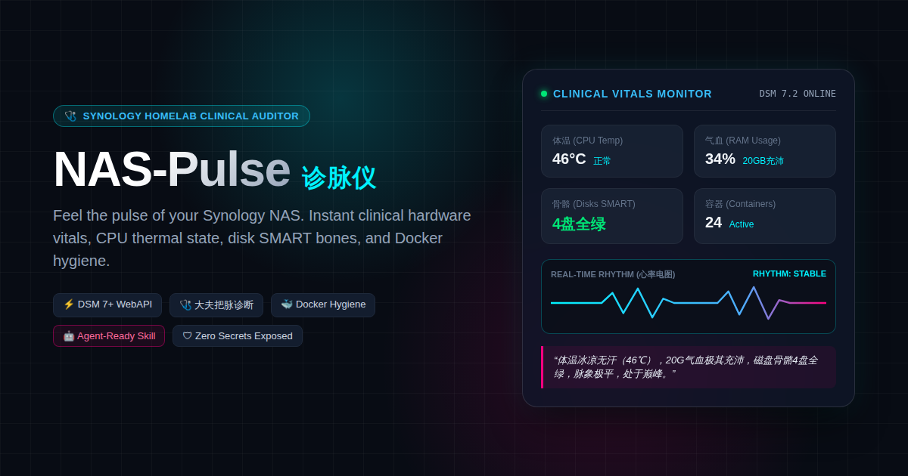
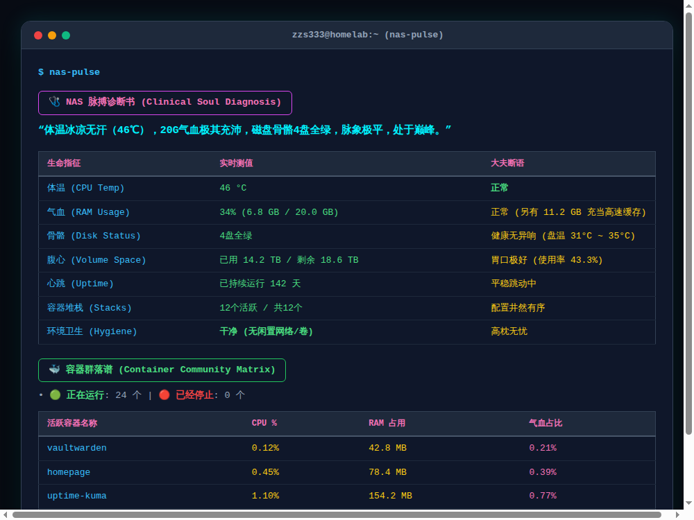

<div align="center">



<br/><br/>

[](https://opensource.org/licenses/MIT)
[](https://www.python.org/downloads/)
[](https://www.synology.com/dsm)
[](https://www.docker.com/)
[](SKILL.md)

### 🩺 给你的群晖 NAS 把脉：实时硬件体温、磁盘骨骼与 Docker 容器群落极速体检
### Feel the pulse of your Synology NAS — Instant clinical hardware vitals & Docker hygiene.

[English](#-english) • [中文说明](#-中文说明)

</div>

---

## 📸 终端诊断实况 / Terminal Preview

<div align="center">
  
</div>

---

<a name="-english"></a>
# 🇬🇧 English

## 🌟 Highlights

- 🩺 **Clinical "Server Doctor" Vitals System**:
  Transforms cold server statistics into vital physiological metrics—**Body Temp** (CPU temperature), **Vitality/Blood** (RAM active/cache), **Skeleton** (Disk SMART health), and **Core** (Volume storage space), followed by an incisive **Soul Diagnosis** from the server doctor.
- ⚡ **Zero-Agent DSM 7+ WebAPI Telemetry**:
  No need to install heavy daemons or external agents on your NAS. Directly queries native Synology WebAPIs with sub-second response times.
- 🐳 **Docker Container Communities & Hygiene Audit**:
  Inspect active and stopped containers, memory hogs, and automatically flag **temporary leftover containers**, **dangling volumes**, and **orphan networks**.
- 🛠️ **Interactive Onboarding & Self-Checking Doctor**:
  Built-in interactive wizard `nas-pulse setup` with live connection tests, plus `nas-pulse doctor` for diagnosing permission traps (such as DSM 7's classic `Error 105`).
- 🤖 **Dual-Mode Operation (Human CLI + AI Agent Skill)**:
  Works as a terminal CLI and a standard **Agent Skill** (`SKILL.md`) for OpenCode, Claude Code, Codex, and Hermes, supporting `--json` export.
- 🛡️ **Zero Secrets Exposed**:
  All credentials remain strictly in your local `.env` (automatically secured with `0600` permissions) and are never transmitted outside.

---

## 🚀 Quickstart

### 1. Clone & Install Dependencies

```bash
git clone https://github.com/zzhang82/nas-pulse.git
cd nas-pulse
pip install -r requirements.txt
```

*(Optional: Install as a global system CLI with `pip install -e .`)*

### 2. Interactive Setup Wizard

Run the built-in wizard to configure your Synology connection in 1 minute:

```bash
nas-pulse setup
# Or: python -m nas_pulse setup
```

The wizard tests connectivity and sensor permissions in real-time.

### 3. Check Server Vitals

```bash
nas-pulse
```

---

## 📖 CLI Commands

| Command | Description |
| :--- | :--- |
| `nas-pulse` | Perform full clinical pulse check and output diagnostic table |
| `nas-pulse setup` | Run interactive onboarding wizard to configure connection |
| `nas-pulse doctor` | Run self-diagnostic checks (Python version, WebAPI RTT, permissions) |
| `nas-pulse --json` | Output machine-readable JSON data for scripting or agents |
| `nas-pulse --env /path/to/.env` | Specify a custom `.env` file location |

---

## 🤖 AI Agent Integration (Skill)

This repository includes a native [`SKILL.md`](SKILL.md) compliant with AI coding agents:
1. Copy or symlink this directory into your agent skills path (e.g. `~/.config/opencode/skills/nas-pulse`).
2. When prompted with:
   > *"Check my NAS health"* / *"How are my NAS containers doing?"* / *"nas-pulse"*
3. Your agent will adopt the persona of a seasoned server clinician, run the diagnostics, and return an actionable health summary!

---

## 📚 In-Depth Synology Guides

- 📖 [How to Create a Dedicated Read-Only DSM User (Avoid Error 105)](docs/DSM_USER_SETUP.md)
- 📖 [Portainer Access Token Configuration Guide](docs/PORTAINER_SETUP.md)
- 📖 [Synology DSM 7+ & Docker Battle-Tested Engineering Handbook](docs/SYNOLOGY_BATTLE_TESTED.md)

---

<br/>

<a name="-中文说明"></a>
# 🇨🇳 中文说明

## 🌟 核心亮点

- 🩺 **首创“大夫诊脉”生命体征系统**：
  将冰冷的服务器指标拟人化为生命体征——**体温**（CPU温度）、**气血**（RAM运行/缓存）、**骨骼**（磁盘 SMART 状态）、**腹心**（存储池空间），并由“老中医大夫”给出一针见血的**灵魂诊断**。
- ⚡ **DSM 7+ WebAPI 零侵入读取**：
  无需在 NAS 上安装任何重量级 Agent 或后台守护进程，通过官方 WebAPI 毫秒级直读硬件物理传感器。
- 🐳 **Docker 容器群落与环境卫生诊断**：
  一览活跃与停止容器、内存大户，自动识别版本迭代后的**临时残留容器**、**悬空无主卷**和**孤儿桥接网络**。
- 🛠️ **新手友好引导 (Interactive Setup & Doctor)**：
  自带交互式配置向导 `nas-pulse setup`，实时发包握手；自带排错命令 `nas-pulse doctor`，遇到群晖经典的 `Error 105` 权限问题时给出清晰指引。
- 🤖 **双模态运行 (Human CLI + AI Agent Skill)**：
  既是一个控制台诊断工具，也是一个标准的 **Agent Skill**（原生支持 OpenCode、Claude Code、Codex、Hermes），支持 `--json` 输出。
- 🛡️ **绝对安全与隐私保护**：
  所有凭据严格保存在本地 `.env`（权限自动设为 `0600`），绝不上传任何遥测数据或外发请求。

---

## 🚀 极速上手

### 1. 克隆并安装依赖

```bash
git clone https://github.com/zzhang82/nas-pulse.git
cd nas-pulse
pip install -r requirements.txt
```

*(可选：如果你喜欢在系统中任意路径直接敲 `nas-pulse`，可执行 `pip install -e .`)*

### 2. 交互式开箱配置

运行自带的配置向导，只需 1 分钟输入你的 NAS IP 和账号：

```bash
nas-pulse setup
# 或者执行：python -m nas_pulse setup
```

### 3. 一键出具体检单

```bash
nas-pulse
```

---

## 📖 使用命令

| 命令 | 说明 |
| :--- | :--- |
| `nas-pulse` | 立即出具完整的 NAS 脉搏诊断书与容器群落谱 |
| `nas-pulse setup` | 启动交互式配置向导（创建或更新连接配置） |
| `nas-pulse doctor` | 运行系统自检（检查依赖、网络握手延迟与权限） |
| `nas-pulse --json` | 以纯 JSON 格式输出完整体检数据（适合二次开发或监控系统） |
| `nas-pulse --env /path/to/.env` | 指定自定义配置文件路径 |

---

## 🤖 AI Agent 集成 (Skill)

本项目原生包含标准 Agent 技能定义文件 [`SKILL.md`](SKILL.md)。

如果你在使用 **OpenCode**, **Claude Code**, **Codex**, 或 **Hermes**：
1. 将当前目录复制或软链接到你的技能目录（例如 `~/.config/opencode/skills/nas-pulse`）。
2. 当你在聊天中问：
   > *"帮我给 NAS 把个脉"* / *"看看 NAS 容器状态"* / *"nas-pulse"*
3. 你的 AI Agent 就会化身经验丰富的服务器老中医，自动调用工具并为你输出标准的体检报告！

---

## 📚 群晖硬核指南

- 📖 [《如何创建最小权限的安全 DSM 诊脉账号 (规避 Error 105)》](docs/DSM_USER_SETUP.md)
- 📖 [《Portainer Access Token 配置指南》](docs/PORTAINER_SETUP.md)
- 📖 [《Synology DSM 7+ & Docker 底层避坑与内核调优指南》](docs/SYNOLOGY_BATTLE_TESTED.md)

---

## 📄 开源许可证 (License)

本项目采用 [MIT License](LICENSE) 开源协议。
